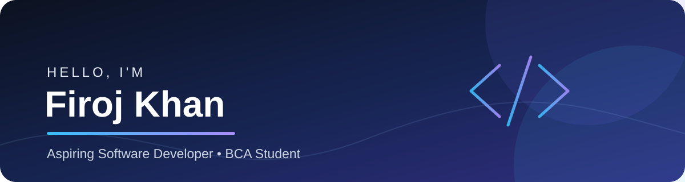

  
  <h3>Software Developer | BCA Student</h3>
  
Building practical applications • Solving problems • Learning every day

  
  

---

## 👨‍💻 About Me

- 🎓 BCA student focused on software development.
- ☕ Practicing **Java**, object-oriented programming, and coding problems.
- 🐍 Building applications with **Python**, **Django**, and **Flask**.
- 🔵 Familiar with **C programming** and core programming concepts.
- 🧩 Improving problem-solving through **Data Structures & Algorithms**.
- 🗄️ Working with SQL and relational databases.

## 🧰 Technical Skills

**Programming Languages**

**Core Concepts**

**Web Development & Frameworks**

**Databases & Developer Tools**

## 🚀 Featured Projects

### 🏫 [MySchool](https://github.com/firojkhan-dev/MySchool)
A responsive school website interface built with HTML, CSS, and JavaScript.

- School information, navigation, notices, and events
- Live digital clock
- Front-end development project

**Technologies:** HTML • CSS • JavaScript

### 📒 [AashMohd — Business Ledger](https://github.com/firojkhan-dev/AashMohd)
A Flask-based application for managing business income and expenses.

- Login-protected dashboard
- Create, edit, delete, search, and filter transactions
- Income, expense, and balance summaries
- PDF transaction reports

**Technologies:** Python • Flask • SQLite • ReportLab

## 📈 GitHub Statistics

  
  
   
  

## 🎯 Current Focus

- Strengthening Java and Python fundamentals
- Revising C programming
- Practicing DSA and interview-style problems
- Building useful web applications

## 🤝 Connect

  
  
<i>Learning • Building • Improving</i>

